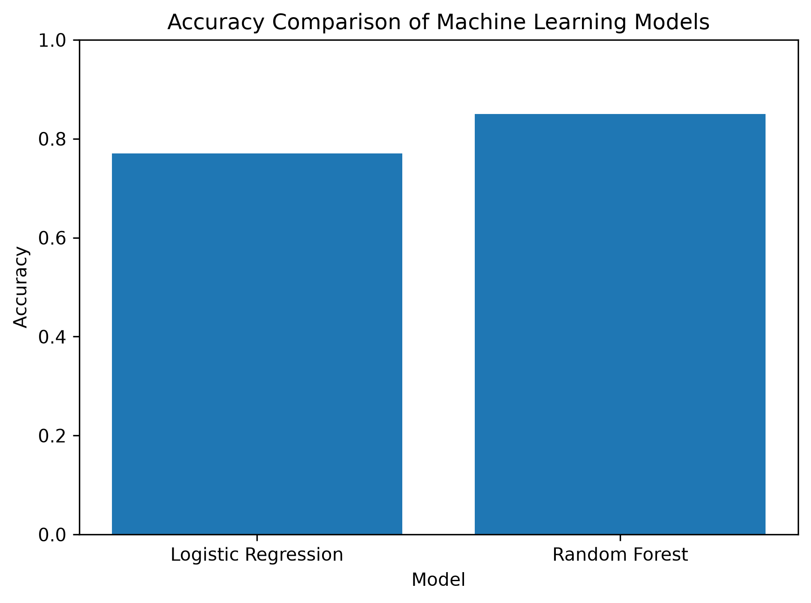

# Cat Shelter Outcomes

For our Data Science course, we looked at what happens to cats leaving the Austin Animal Center. We wanted to understand the patterns in the data and see whether a model could distinguish adoption from other outcomes.

## What we did

We started with the Austin Animal Center Outcomes dataset and filtered it to cats. After cleaning, we had 69,386 records.

We explored outcomes by age, sex upon outcome and breed, then trained two models:

- Logistic Regression
- Random Forest

Both models used age, breed and sex upon outcome as features. We split the data into 80% for training and 20% for testing, with adoption as one class and all other outcomes as the other.

## What we found

| Model | Test accuracy |
|---|---:|
| Logistic Regression | 77.03% |
| Random Forest | 85.05% |

In the Random Forest model, sex upon outcome had the highest feature importance, followed by age and breed. These scores tell us which features the model relied on—not what caused a cat to be adopted.



## A limitation worth noting

The model uses **age and sex upon outcome**. In particular, sex upon outcome includes spay/neuter status, which may change while a cat is at the shelter. Because these details are recorded at outcome, we can't assume the model would perform the same way for a cat just arriving at a shelter.

The project uses a random split of records from one shelter. Testing on future records and data from other shelters would be useful next steps. The categorical features were also encoded before the split; a future version could move that preprocessing into a training pipeline.

## Running the project

Keep `austin_outcomes_2025.csv` in the same folder as `cat_shelter_analysis.py`, then install the libraries:

```bash
python -m pip install pandas numpy matplotlib seaborn scikit-learn
```

Run:

```bash
python cat_shelter_analysis.py
```

The results will appear in the terminal, and the graphs will be saved in the `outputs` folder.

## Team

This was a group project for CSCI 4343 Data Science at IIUM.

- Amni Nuwairah binti Abdul Hanan
- Nik Muhammad Aliff bin Nik Azman
- Noor Zafirah Alya binti Noor Shiz​​arin
- Nur’alya Farisya binti Hairil Anuar
- Yasmin Hanani Salsabila binti Md Hakiim